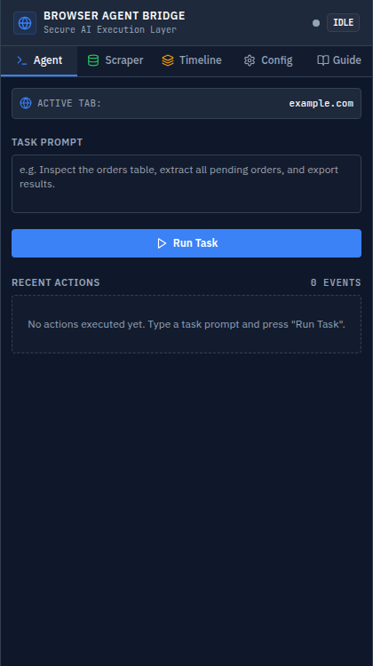
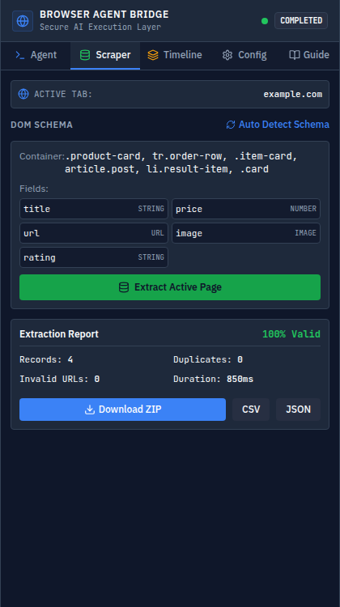
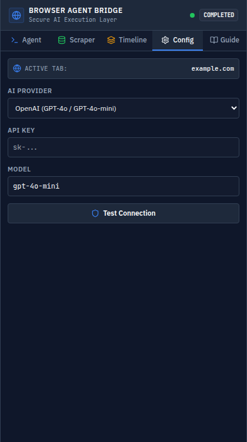
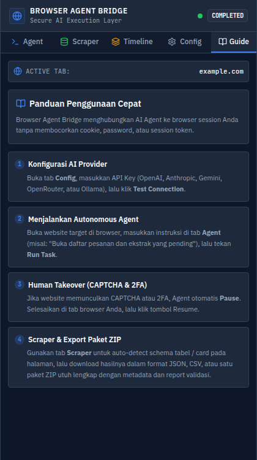

<div align="center">

# 🌐 Browser Agent Bridge

**Secure AI Execution Layer & Autonomous Browser Automation for Chromium**

[](https://www.typescriptlang.org/)
[](https://developer.chrome.com/docs/extensions/mv3/intro/)
[](https://vitejs.dev/)
[](https://tailwindcss.com/)
[](https://vitest.dev/)
[](LICENSE)

<p align="center">
  <b>Never give your cookies, passwords, or session tokens to an AI model.</b><br>
  Browser Agent Bridge enables autonomous AI workflows while keeping complete credential authority inside your browser.
</p>

---


&nbsp;&nbsp;&nbsp;&nbsp;


</div>

---

## 💡 The Problem & Core Concept

Standard AI web agents ask you to hand over cookies, passwords, or complete remote browser sessions, creating catastrophic credential exposure.

**Browser Agent Bridge introduces a Zero-Trust Execution Layer:**

```text
               User's Authenticated Browser
                          │
  ┌───────────────────────▼────────────────────────┐
  │         BROWSER AGENT BRIDGE (MV3)             │
  │                                                │
  │  • Redaction Engine (Masks Passwords & Tokens) │
  │  • Policy Engine & Risk Classifier             │
  │  • Visual Highlighting & CAPTCHA Interceptor   │
  │  • Scraping & Validation Engine                │
  └───────────────────────▲────────────────────────┘
                          │ (Approved Actions Only)
                          │ (Zero Credentials Exposed)
  ┌───────────────────────┴────────────────────────┐
  │                 AI AGENT                       │
  │   (OpenAI / Claude / Gemini / Ollama / etc.)   │
  └────────────────────────────────────────────────┘
```

---

## ✨ Key Features

| Feature | Description |
| :--- | :--- |
| 🛡️ **Zero-Credential Exposure** | AI never receives raw cookies, session storage, auth tokens, or passwords. |
| 🤖 **Multi-Provider AI Core** | Native adapters for **OpenAI** (GPT-4o), **Anthropic** (Claude 3.5 Sonnet), **Google Gemini** (2.0 Flash), **OpenRouter**, and **Ollama** (Local/Offline). |
| 🔒 **Sensitive Redaction** | Auto-redacts JWTs, Bearer Tokens, API keys, passwords, and credit card numbers from DOM context. |
| 🛑 **Prompt Injection Defense** | Encapsulates webpage content within isolated `<UNTRUSTED_CONTENT>` semantic boundaries. |
| 👤 **Human-in-the-Loop & Takeover** | Auto-detects CAPTCHA (Cloudflare Turnstile, reCAPTCHA, hCaptcha) and 2FA challenges, pauses execution, and lets the human verify before resuming. |
| 📊 **Autonomous DOM Scraper** | Automatic repeating structure detection, schema proposer, and dataset validation (completeness, duplicate detector). |
| 📦 **All-in-One ZIP Export** | Generates full datasets (`data.json`, `data.csv`, `data.jsonl`, `metadata.json`, `extraction-report.json`, screenshots). |
| ⚡ **Live Action Overlay** | Non-blocking 60 FPS visual bounding box highlight on active web elements. |

---

## 📸 Screenshots

<div align="center">
  <table>
    <tr>
      <td align="center"><b>🤖 Autonomous Agent</b></td>
      <td align="center"><b>📊 Scraper & Validation</b></td>
    </tr>
    <tr>
      <td></td>
      <td></td>
    </tr>
    <tr>
      <td align="center"><b>⚙️ Multi-Provider Settings</b></td>
      <td align="center"><b>📖 Interactive User Guide</b></td>
    </tr>
    <tr>
      <td></td>
      <td></td>
    </tr>
  </table>
</div>

---

## 🛠️ Quick Installation

### 1. Clone & Build
```bash
git clone https://github.com/h1ntz0/BrowserRemote-Agents.git
cd BrowserRemote-Agents
npm install
node build.js
```

### 2. Load into Chromium (Chrome, Brave, Edge)
1. Open `chrome://extensions` in your browser.
2. Enable **Developer mode** (toggle in the top right corner).
3. Click **Load unpacked**.
4. Select the `dist/` directory inside this repository.
5. Click the extension icon in your browser toolbar to open the Side Panel.

---

## 🧭 Step-by-Step Usage Guide

### 1️⃣ Configure Provider
* Navigate to the **Config** tab.
* Choose your provider (**OpenAI**, **Anthropic**, **Gemini**, **OpenRouter**, or **Ollama**).
* Enter your API Key and click **Test Connection**.

### 2️⃣ Run Autonomous Task
* Open any webpage (e.g. order management, e-commerce catalog, or dashboard).
* On the **Agent** tab, type your instruction:
  ```text
  Inspect the orders table, extract all pending orders, and prepare the dataset.
  ```
* Click **Run Task** and watch the agent execute actions safely with live element highlights.

### 3️⃣ Human Takeover (CAPTCHA & 2FA)
* When a website triggers a verification challenge, the agent automatically transitions to `WAITING_HUMAN`.
* Complete the puzzle or 2FA prompt in your browser tab.
* Click **Verification Complete (Resume)** in the Side Panel to continue.

### 4️⃣ Data Extraction & ZIP Export
* Go to the **Scraper** tab.
* Click **Auto Detect Schema** to inspect repeating table rows or cards.
* Click **Extract Active Page**.
* Click **Download ZIP** to get a clean archive with JSON, CSV, metadata, and quality reports.

---

## 🧪 Testing

Run the full automated test suite (unit tests for Policy Engine, Security Redaction, Dataset Validation, and Export Engine):

```bash
npm run test
```

---

## 📂 Project Architecture

```text
BrowserRemote-Agents/
├── src/
│   ├── agent/           # Autonomous ReAct Execution Loop & Planner
│   ├── background/      # MV3 Background Service Worker
│   ├── content/         # Content Script Executor & Visual Overlay
│   ├── export/          # Exporter (JSON, CSV, JSONL, JSZip Package)
│   ├── policy/          # Policy Engine & Risk Classification
│   ├── protocol/        # Typed RPC Protocol & Schemas
│   ├── providers/       # Multi-Provider Adapters (OpenAI, Anthropic, Gemini, Ollama)
│   ├── scraper/         # Structure Detector & Data Validator
│   ├── security/        # Redaction Engine & Prompt Injection Guard
│   ├── sidepanel/       # React + Tailwind Side Panel Interface
│   └── tools/           # Browser Tool Registry & Action Executors
├── dist/                # Production extension bundle ready to load
├── tests/               # Vitest automated test suite
├── build.js             # Standalone clean builder
└── package.json
```

---

## 📄 License

MIT License © 2026 [h1ntz0](https://github.com/h1ntz0)
